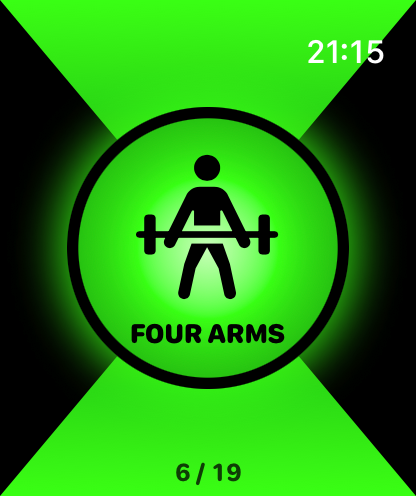
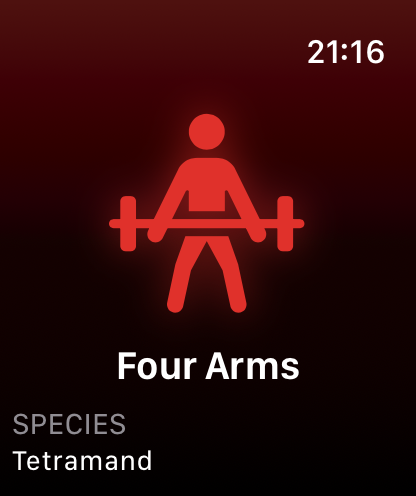

# Omnitrix ⌚️

A small watchOS fan app inspired by the original *Ben 10* series. Turn the **Digital Crown** to scroll through all 19 original aliens, then **tap the dial to transform**.

| Select | Transform |
|---|---|
|  |  |

> **Unofficial fan project, not affiliated with or endorsed by Cartoon Network or Warner Bros. Discovery.**
> "Ben 10", "Omnitrix", all character names and any character artwork belong to Cartoon Network / Warner Bros. Discovery. The source code is MIT; the artwork is **not** covered by that license. This app isn't on the App Store and never will be. It's for developers to build and run on their own watch, with no monetisation.

## Features

- 19 original-series aliens, from Heatblast to Way Big
- Digital Crown selection with haptic detents that wraps around both ways
- Full-screen, edge-to-edge Omnitrix face
- Tap to transform: green flash, haptics, then the alien's art, species, homeworld and power
- Revert back to the dial
- Pure SwiftUI, watch-only app, no network, no data collected

## Requirements

- A Mac with **Xcode 15 or later**
- An **Apple Watch on watchOS 10+**, paired with an iPhone
- An Apple ID. A free "Personal Team" works; a paid developer account isn't required

## Build & install on your watch

```bash
git clone https://github.com/Ismail-2022/Omnitrix.git
cd Omnitrix
cp Config/Local.xcconfig.example Config/Local.xcconfig
```

1. Edit `Config/Local.xcconfig`:
   - `DEVELOPMENT_TEAM`: your Team ID (Xcode → Settings → Accounts → your Apple ID → Team).
   - `BUNDLE_ID_PREFIX`: something unique to you, e.g. `com.yourname`.

   This file is gitignored, so your Team ID never ends up in a commit.
2. Open `Omnitrix.xcodeproj` in Xcode.
3. Turn on **Developer Mode** on your iPhone *and* your watch (Settings → Privacy & Security → Developer Mode).
4. Select the **Omnitrix** scheme and your Apple Watch as the run destination, then press **Run (⌘R)**.
5. The first time, trust the developer certificate on the watch if prompted (Settings → General → VPN & Device Management).

> With a free Apple ID, the app's signing expires after 7 days. Just hit Run again to reinstall.

## Alien artwork

Each alien shows its artwork if there's an image for it in `Omnitrix/Assets.xcassets/AlienArt/`, and its SF Symbol if there isn't. To add or replace art, put the images in a folder, named after each alien (lowercase, letters/digits only):

```
heatblast  wildmutt  diamondhead  xlr8  greymatter  fourarms  stinkfly
ripjaws  upgrade  ghostfreak  cannonbolt  wildvine  blitzwolfer  snareoh
frankenstrike  upchuck  ditto  eyeguy  waybig
```

(`.png` with a transparent background looks best; `.jpg`/`.webp` work too.) Then run:

```bash
Scripts/import-alien-art.sh ~/path/to/your/images
```

The script resizes everything to max 400px and wires it into the asset catalog. Rebuild and you're done.

No watch? Pick any Apple Watch simulator as the destination. In the simulator, scroll on the trackpad or mouse to turn the crown.

## Run the tests

```bash
xcodebuild test -project Omnitrix.xcodeproj -scheme Omnitrix \
  -destination 'platform=watchOS Simulator,name=Apple Watch Series 11 (46mm)'
```

(Use any watch simulator listed by `xcrun simctl list devices`.)

## Project layout

```
Omnitrix/
├── Models/       Alien + AlienRoster (the 19 aliens, crown → index mapping)
├── Views/        DialView, AlienArtView, TransformFlashView, AlienDetailView, ContentView
└── Assets.xcassets
OmnitrixTests/    Roster + crown-wrap unit tests
Config/           Shared xcconfig + your local signing override
Scripts/          import-alien-art.sh
project.yml       XcodeGen spec (optional: `xcodegen generate` rebuilds the .xcodeproj)
```

The `.xcodeproj` is committed, so you **don't** need XcodeGen to build. It's only needed if you change `project.yml`.

## Contributing

Issues and PRs are welcome. To add or tweak an alien, edit `Omnitrix/Models/AlienRoster.swift`.

## License

[MIT](LICENSE) for the source code only. Character names and artwork are the property of Cartoon Network / Warner Bros. Discovery and are included as an unofficial, non-commercial fan tribute. If you're a rights holder and want anything removed, open an issue and it'll be taken down.
